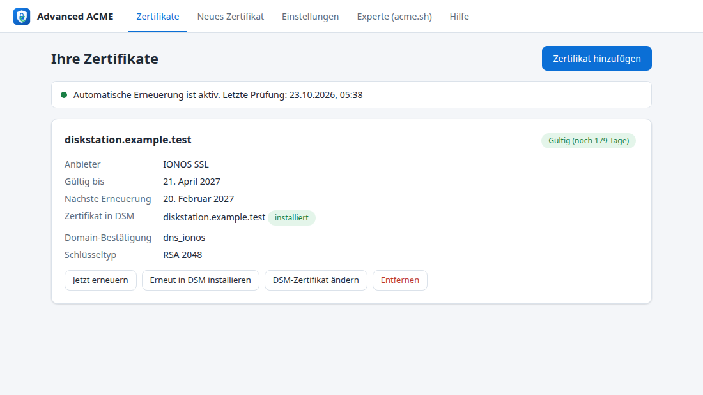
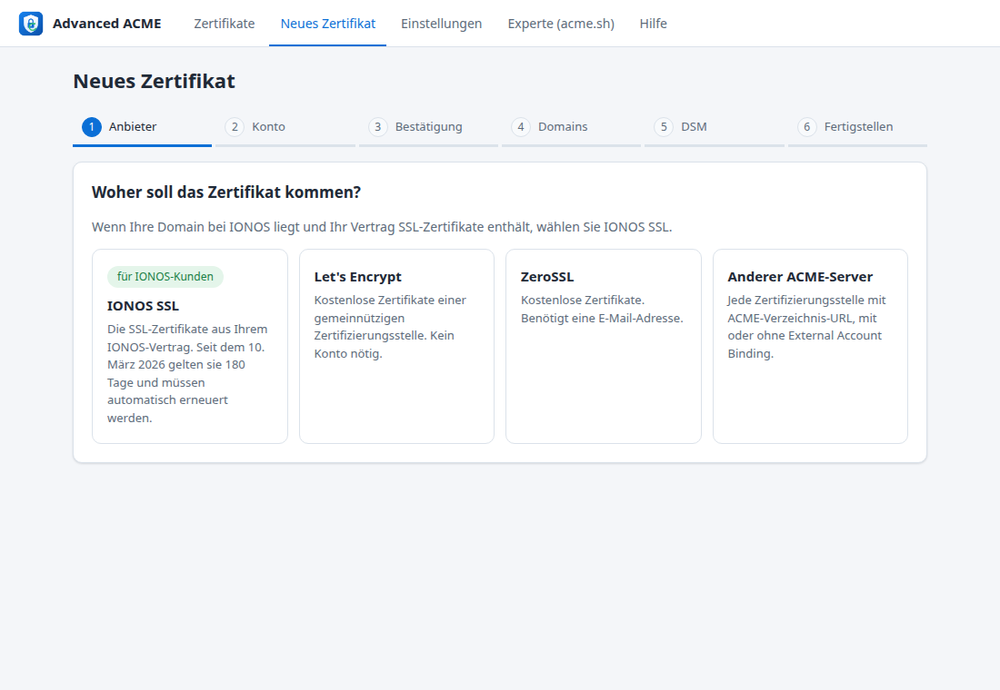
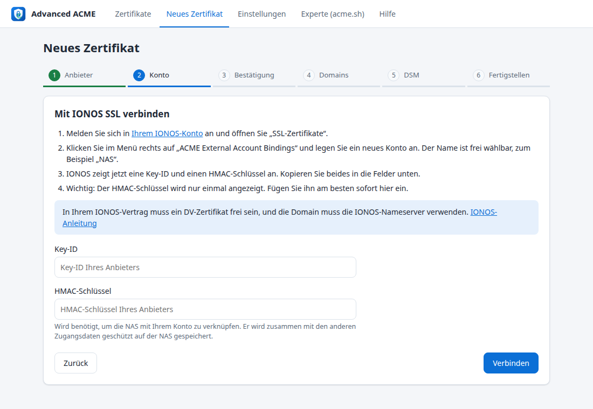
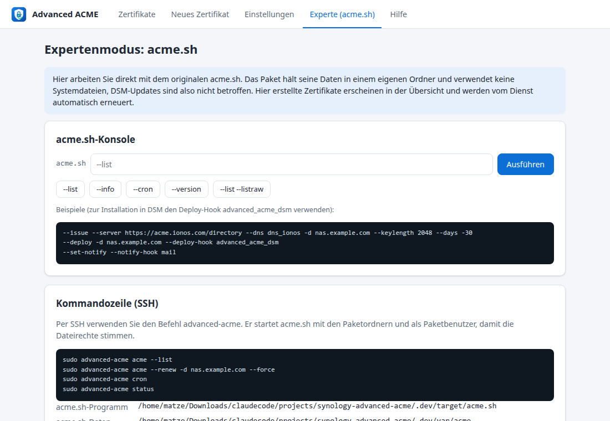

# Advanced ACME für Synology DSM

[English version](README.md)

Automatische SSL-Zertifikate für Synology DSM 7 von **IONOS SSL**, Let's Encrypt, ZeroSSL oder jedem anderen ACME-Server. Die Einrichtung läuft über einen geführten Assistenten, die Erneuerung geschieht automatisch.

Seit dem 10. März 2026 stellt IONOS SSL-Zertifikate mit einer technischen Gültigkeit von **180 Tagen** statt einem Jahr aus. Ein von Hand installiertes Zertifikat müsste also zweimal im Jahr getauscht werden. Der IONOS-ACME-Server verlangt *External Account Binding* (EAB), das der Zertifikatsdialog von DSM nicht beherrscht. Advanced ACME schließt diese Lücke.



## Funktionen

- **Geführter Assistent für Laien**, IONOS steht an erster Stelle. Er erklärt Schritt für Schritt, wo man die EAB-Daten (Key-ID und HMAC-Schlüssel) und den IONOS-DNS-API-Schlüssel findet, prüft jede Eingabe sofort und zeigt die Domains des IONOS-Kontos zur Auswahl an.
- **DNS-Bestätigung (DNS-01)**: Die NAS muss nicht aus dem Internet erreichbar sein, es werden keine Ports geöffnet. Unterstützt werden IONOS und alle über 200 DNS-Anbieter von acme.sh. Die Formulare für diese Anbieter entstehen aus den acme.sh-Plugins.
- **Native DSM-Integration**: Die Zertifikate werden über die offizielle DSM-WebAPI in *Systemsteuerung > Sicherheit > Zertifikat* installiert. Man kann ein neues Zertifikat anlegen oder ein vorhandenes ersetzen. Zuordnungen zu Diensten, etwa DSM-Desktop oder Reverse Proxy, bleiben bei jeder Erneuerung erhalten.
- **Automatische Erneuerung** durch einen Paketdienst, zweimal täglich, standardmäßig 30 Tage vor Ablauf. Der Dienst unterstützt ACME Renewal Information (ARI), die Zertifizierungsstelle kann also eine frühere Erneuerung anfordern.
- **2-Faktor-Authentifizierung**: Der Code wird einmal gebraucht, danach ist die NAS als vertrauenswürdiges Gerät hinterlegt.
- **Expertenmodus**: eine acme.sh-Konsole im Browser und der Befehl `advanced-acme` für SSH. Dort erstellte Zertifikate erscheinen ebenfalls in der Übersicht und werden automatisch erneuert.
- **acme.sh-Updates (optional, experimentell)**: Neuere offizielle acme.sh-Releases lassen sich unter *Einstellungen* installieren, von Hand oder automatisch einmal täglich. Die mitgelieferte Version bleibt erhalten, ein Klick führt zu ihr zurück. Getestet ist Advanced ACME nur mit der mitgelieferten Version.
- **Alle 20 DSM-Sprachen**: Deutsch, Englisch, Französisch, Italienisch, Spanisch, Niederländisch, Polnisch, Portugiesisch, Russisch, Schwedisch, Dänisch, Norwegisch, Tschechisch, Türkisch, Ungarisch, Thai, Japanisch, Koreanisch sowie vereinfachtes und traditionelles Chinesisch. Die App folgt der DSM-Sprache, außerhalb von DSM der Browsersprache.

| Assistent: Anbieter | Assistent: IONOS-Konto | Expertenmodus |
|---|---|---|
|  |  |  |

## Warum ein Paket und kein Umbau des DSM-Zertifikatsdialogs?

Der Zertifikatsdialog gehört zum Betriebssystem und liegt unter `/usr/syno`. Jede Änderung dort überschreibt das nächste DSM-Update. Sie kann außerdem das Update scheitern lassen oder DSM in einem inkonsistenten Zustand zurücklassen. Advanced ACME hält sich deshalb strikt an unterstützte Schnittstellen:

| | Advanced ACME |
|---|---|
| Systemdateien | keine verändert |
| Root-Rechte | nicht nötig: läuft als eigener Paketbenutzer (DSM-7-Standard) |
| Cronjobs | keine, der Sicherheitsberater von DSM meldet also keine Warnung. Erneuert wird im Paketdienst |
| Daten | `/var/packages/AdvancedACME/var`, übersteht DSM- und Paket-Updates |
| Zertifikatsinstallation | offizielle DSM-WebAPI, derselbe Weg wie beim `synology_dsm`-Hook von acme.sh |
| acme.sh | das Original, gebündelt als offizielles Release 3.1.6 mit einer kleinen Anpassung (siehe unten); neuere Releases lassen sich optional installieren |

## Installation

1. `AdvancedACME-<version>-noarch.spk` aus den Releases herunterladen oder selbst bauen (siehe unten).
2. In DSM **Paket-Zentrum > Manuelle Installation** öffnen und die Datei auswählen. DSM weist darauf hin, dass das Paket nicht von Synology signiert ist. Das ist bei Drittanbieter-Paketen normal.
3. **Advanced ACME** im Hauptmenü öffnen und dem Assistenten folgen.

Voraussetzungen: DSM 7.0 oder neuer, beliebige CPU-Architektur (`noarch`).

### Was Sie für IONOS brauchen

- Einen IONOS-Vertrag mit einem freien **DV-Zertifikat**. OV- und EV-Zertifikate lassen sich nicht per ACME ausstellen.
- Die Domain muss die **IONOS-Nameserver** verwenden.
- **EAB-Daten**: Im IONOS-Konto *SSL-Zertifikate* öffnen, dann *ACME External Account Bindings* ([direkter Link](https://ssl.ionos.de/certificates/acme-accounts)), dann *Konto anlegen*. Sie erhalten eine Key-ID und einen HMAC-Schlüssel. Der HMAC-Schlüssel wird nur einmal angezeigt.
- **Ein vorhandenes, von Hand eingerichtetes IONOS-Zertifikat** muss einmal mit ACME verknüpft werden: Auf der IONOS-Seite *SSL-Zertifikate* beim Zertifikat *Verwalten*, dann *Erweiterte Einstellungen* > *Zu ACME migrieren* wählen und die External Account Binding auswählen. Sonst beantwortet IONOS die Anfrage mit „No available certificate found for the requested domain(s)“.
- **IONOS-API-Schlüssel** für die DNS-Einträge: im [IONOS-Entwicklerportal](https://developer.hosting.ionos.de/docs/getstarted) anlegen. Er besteht aus einem öffentlichen Präfix und einem Secret.
- **Ein DSM-Administratorkonto**, das einmal eingegeben wird. Standardmäßig legt der Assistent damit ein eigenes Konto `advanced-acme` an (Mitglied von `administrators`, langes Zufallspasswort) und speichert nur dieses Konto. Ihr eigenes Passwort wird also nie gespeichert. Fortgeschrittene können stattdessen ein vorhandenes Konto eingeben. Solange kein DSM-Konto eingerichtet ist, beginnt der Assistent mit diesem Schritt. DSM-Richtlinien für neue Konten werden berücksichtigt: Verlangt DSM bei der ersten Anmeldung ein neues Passwort, setzt das Konto selbst ein anderes Zufallspasswort.
- **Ohne Konto: die DSM-Aufgabe.** Verlangt DSM die 2-Faktor-Authentifizierung für alle Administratoren, kann sich kein eigenes Konto anmelden. Advanced ACME bietet dann an, stattdessen die Aufgabe „Advanced ACME“ im DSM-Aufgabenplaner anzulegen (eine Administrator-Anmeldung, DSM fragt das Passwort noch einmal ab). Die Aufgabe läuft jede Minute als root und installiert erneuerte Zertifikate lokal mit DSMs eigenem `synowebapi`, so wie DSM seine Let's-Encrypt-Zertifikate installiert. Es werden weder DSM-Konto noch Passwort gespeichert. Die Fehlermeldung nennt auch die Alternative: das Konto ausnehmen, indem man bei der 2-Faktor-Pflicht „Benutzerdefiniert“ wählt und die Administratoren einzeln markiert.

## Sicherheit

- Nur DSM-Administratoren können die Anwendung öffnen. Das Backend prüft bei jeder Anfrage die DSM-Sitzung und die Mitgliedschaft in der Gruppe `administrators`. Anfragen brauchen einen eigenen Header, das schützt vor CSRF.
- Zugangsdaten (DNS-API-Schlüssel, DSM-Konto, EAB-Daten) liegen im Datenordner des Pakets. Der Ordner hat die Rechte `700`, die Dateien `600`, nur der Paketbenutzer kann sie also lesen. Das DSM-Passwort wird nur einmal gespeichert, in `secrets/dsm.conf`, und nicht in jede acme.sh-Domainkonfiguration kopiert.
- Das Konto `advanced-acme` wird über die DSM-WebAPI angelegt, ohne root-Rechte. DSM verweigert die Benutzerverwaltung über die Loopback-Adresse, deshalb laufen diese Aufrufe über die eigene Netzwerkadresse der NAS; Zertifikate werden wie bisher über `localhost` installiert. *Konto entfernen* in den Einstellungen, der Wechsel zu einem anderen Konto oder die Deinstallation mit *Daten löschen* löscht es wieder aus DSM.
- Das Skript der DSM-Aufgabe steht in der Aufgabe selbst (gehört root). Es führt keine Dateien des Pakets aus, liest nur die übergebenen Zertifikate, prüft sie und schreibt seine Ergebnisse nach `/run/advanced-acme`, das root gehört. Es löscht sich selbst, wenn Sie es in Advanced ACME entfernen oder das Paket deinstallieren.
- Jeder solche Schritt (Konto angelegt oder gelöscht, Aufgabe angelegt, Zertifikat durch die Aufgabe installiert, Aufgabe entfernt) steht unter *Einstellungen > Verlauf*.
- Geheimnisse gehen über die Umgebung an Hintergrundaufgaben, nie über die Kommandozeile. Eine Ausnahme: Die EAB-Daten erhält acme.sh beim einmaligen `--register-account` als Argument, weil acme.sh sie nur so annimmt.
- Variablen für DNS-Plugins sind pro Plugin freigegeben, der Browser kann also keine Variablen wie `PATH` setzen. Die Expertenkonsole sperrt Optionen, die acme.sh verschieben oder aktualisieren würden (`--home`, `--upgrade`, `--install` und weitere).

## acme.sh-Updates

Das Paket bringt das acme.sh-Release mit, mit dem es getestet wurde (derzeit 3.1.6). Unter *Einstellungen > acme.sh-Version* können Sie nach neueren offiziellen Releases suchen, eines installieren oder neue Releases einmal täglich automatisch vom Erneuerungsdienst installieren lassen. Diese Versionen sind **mit Advanced ACME experimentell**, solange eine aktiv ist, zeigt die Oberfläche einen Hinweis.

- Das Update kommt aus den offiziellen acme.sh-Releases auf GitHub und wird im Datenordner installiert (`var/acme-sh`). Die mitgelieferte Kopie wird nie verändert.
- Am mitgelieferten acme.sh und an jedem Update wird eine kleine Anpassung vorgenommen ([src/lib/acmepatch.sh](src/lib/acmepatch.sh)): Nach dem Abschluss der Bestellung fragte acme.sh nur 30-mal im Abstand von 2 Sekunden nach dem Zertifikat. Der IONOS-ACME-Server braucht oft mehrere Minuten, daher gab acme.sh auf, obwohl IONOS das Zertifikat ausgestellt hat. Mit der Anpassung fragt es mit wachsenden Pausen (2, 5, 10, danach 20 Sekunden) etwa 9 Minuten lang nach. Ändert ein späteres acme.sh-Release diesen Code, entfällt die Anpassung.
- Ein Update wird abgelehnt, wenn das Archiv nicht die erwartete Version enthält, wenn der Synology-Hook oder das IONOS-Plugin fehlt oder wenn ein DNS-Plugin entfernt wurde, das eines Ihrer Zertifikate nutzt.
- *Zur mitgelieferten Version zurückkehren* löscht die aktualisierte Kopie. Zertifikate und Einstellungen bleiben unverändert.
- Bringt ein späteres Paket-Update ein neueres acme.sh mit als das installierte Update, wird automatisch wieder die mitgelieferte Version verwendet.

## Kommandozeile (SSH)

```bash
sudo advanced-acme acme --list
```

```bash
sudo advanced-acme acme --renew -d nas.example.com --force
```

```bash
sudo advanced-acme cron
```

```bash
sudo advanced-acme acme-update
```

`advanced-acme` wechselt automatisch zum Paketbenutzer, damit die Dateirechte stimmen. Zum Installieren in DSM dient der Deploy-Hook `advanced_acme_dsm`. Er nutzt das DSM-Konto aus den Einstellungen und ruft den originalen `synology_dsm`-Hook von acme.sh auf.

## Sprachen

Alle Texte kommen aus Sprachkatalogen, Englisch ist Basis- und Rückfallsprache:

- `src/ui/i18n/<sprache>.json`: die Weboberfläche (BCP-47-Codes wie `fr`, `pt-BR`, `zh-TW`)
- `src/ui/texts/<DSM-Code>/strings`: Eintrag im Hauptmenü und DSM-Benachrichtigungen (DSM-Codes wie `fre`, `ptb`, `cht`)
- `package/descriptions/<DSM-Code>.txt`: Beschreibung im Paket-Zentrum

Die Sprache kommt aus der DSM-Sitzung, außerhalb von DSM aus dem Browser. Sie lässt sich auch unter *Einstellungen > Sprache* festlegen. Außer Deutsch und Englisch sind die Übersetzungen noch nicht von Muttersprachlern geprüft, Korrekturen sind willkommen. Der Assistent verlinkt auf die IONOS-Seite des jeweiligen Landes, wo es eine gibt (ionos.de, .fr, .es, .it), sonst auf ionos.com. `python3 tests/check-i18n.py` meldet fehlende, überzählige oder inkonsistente Texte in jeder Sprache. Für eine neue Sprache legen Sie die drei Dateien oben an und ordnen den DSM-Code in `DSM_LANGS` in `src/ui/app.js` zu.

Die acme.sh-Protokolle unter *Technische Details anzeigen* bleiben englisch.

## Aufbau des Projekts

```
src/bin/advanced-acme            CLI und Erneuerungsdienst
src/lib/*.sh                     Backend (bash 4.4, wie in DSM 7 enthalten)
src/ui/                          Weboberfläche, CGI-API, DSM-App-Integration, Sprachkataloge
src/acme-hooks/deploy/           Deploy-Hook advanced_acme_dsm
package/                         SPK-Steuerdateien und Beschreibungen fürs Paket-Zentrum (INFO erzeugt build.sh)
vendor/acme.sh/                  offizielles acme.sh-Release (GPL-3.0), siehe tools/update-vendor.sh
tests/                           Ende-zu-Ende-Test mit Pebble und DSM-/IONOS-Mock
tools/                           Hilfsskripte für den Build
```

## Bauen

```bash
./build.sh
```

Das Ergebnis liegt in `dist/AdvancedACME-<version>-noarch.spk`. Benötigt werden bash, tar und python3. Die Version steht in `VERSION`.

Andere Paketsysteme können nur die Paketinhalte übernehmen: `./build.sh --stage VERZEICHNIS` schreibt die Dateien von `package.tgz` nach `VERZEICHNIS` und verwendet ein dort unter `acme.sh` bereits vorhandenes acme.sh statt `vendor/acme.sh`. Mit `ACME_UPDATES=0` entfallen die optionalen acme.sh-Updates in der Oberfläche; acme.sh wird dann nur mit dem Paket aktualisiert. Advanced ACME ermittelt Paketnamen und Paketbenutzer zur Laufzeit, das Paket darf also anders heißen (zum Beispiel `advanced-acme` mit dem Benutzer `sc-advanced-acme`).

## Tests

Der Ende-zu-Ende-Test durchläuft den kompletten Ablauf über die CGI-API gegen [Pebble](https://github.com/letsencrypt/pebble). Pebble ist eingerichtet wie der IONOS-ACME-Server: External Account Binding ist Pflicht, Zertifikate gelten 180 Tage. Ein Mock der DSM-WebAPI (Anmeldung, 2-Faktor-Authentifizierung, Zertifikatsliste und Import, Benutzerverwaltung) und der IONOS-DNS-API vertritt die NAS. Geprüft werden Registrierung mit EAB, Wildcard-Zertifikat per DNS-01, Installation in DSM, Ersetzen des DSM-Standardzertifikats, 2FA-Geräte-Token, Erneuerung, ECDSA, Expertenkonsole, Dienst und Eingabeprüfung.

```bash
go install github.com/letsencrypt/pebble/v2/cmd/pebble@latest github.com/letsencrypt/pebble/v2/cmd/pebble-challtestsrv@latest
```

```bash
tests/e2e.sh
```

```bash
python3 tests/check-i18n.py
```

`tests/dev-env.sh` startet dieselbe Umgebung mit der Weboberfläche unter `http://127.0.0.1:8099/index.html`, zum Arbeiten an der Oberfläche.

## Stand und Grenzen

- **Beta.** Ende zu Ende getestet gegen Pebble und einen DSM-WebAPI-Mock sowie auf Virtual DSM 7.2.2: Installation, App im DSM-Hauptmenü, Anmeldung über die DSM-Sitzung, Ausstellen und Installieren eines Zertifikats, Ersetzen des DSM-Standardzertifikats, Anlegen und Löschen des DSM-Dienstkontos, die DSM-Aufgabe bei 2-Faktor-Pflicht für alle Administratoren (inklusive Ersetzen des Standardzertifikats und Selbstlöschung bei Deinstallation), Erneuerungsdienst, Upgrade und Deinstallation. Noch nicht gegen den echten IONOS-ACME-Server getestet.
- IONOS dokumentiert seinen ACME-Server mit Certbot und win-acme. Advanced ACME nutzt DNS-01 über die IONOS-DNS-API. Das setzt die IONOS-Nameserver voraus, die IONOS ohnehin verlangt.
- Wird ein Zertifikat aus Advanced ACME entfernt, bleibt es in DSM erhalten. Löschen Sie es dort, wenn Sie es nicht mehr brauchen.
- Beim Deinstallieren fragt ein Dialog, ob die gespeicherten Zugangsdaten und acme.sh-Daten gelöscht werden sollen (vorausgewählt). Beim Löschen wird auch das DSM-Konto `advanced-acme` entfernt, falls Advanced ACME es angelegt hat. Behalten Sie sie, macht eine Neuinstallation damit weiter. In DSM installierte Zertifikate bleiben in jedem Fall erhalten, werden aber nicht mehr erneuert.

## SynoCommunity

Eine Veröffentlichung im Repository von [SynoCommunity](https://synocommunity.com) ist geplant, sobald das Paket auf echten DiskStations getestet ist. SynoCommunity baut alle Pakete mit dem Framework [spksrc](https://github.com/SynoCommunity/spksrc). Das Paket muss dafür in ein spksrc-`spk/`-Makefile überführt werden (noarch, `SERVICE_USER = auto`, DSM-Oberfläche). Für die Aufnahme sind außerdem eine getestete Neuinstallation und ein getestetes Upgrade nötig.

## Lizenz

GPL-3.0, siehe [LICENSE](LICENSE). Enthält [acme.sh](https://github.com/acmesh-official/acme.sh) (GPL-3.0).

Synology und DSM sind Marken der Synology Inc. IONOS ist eine Marke der IONOS SE. Dieses Projekt steht mit keinem der beiden Unternehmen in Verbindung.
