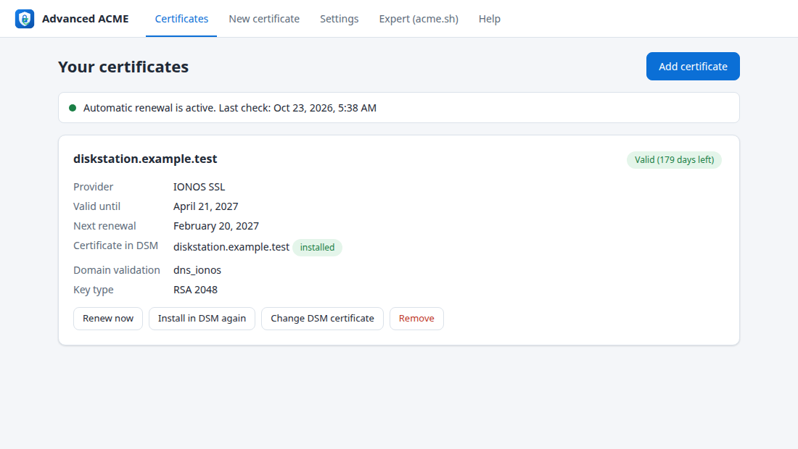
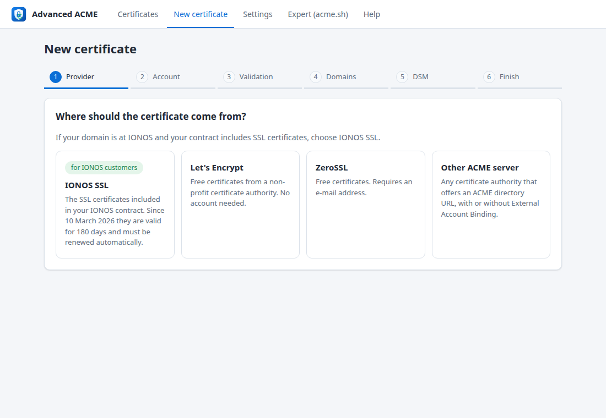
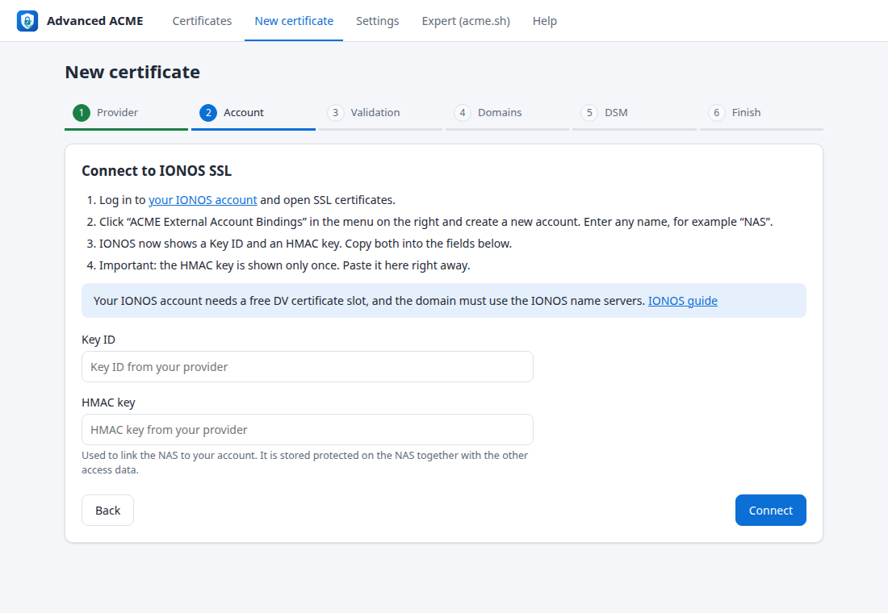
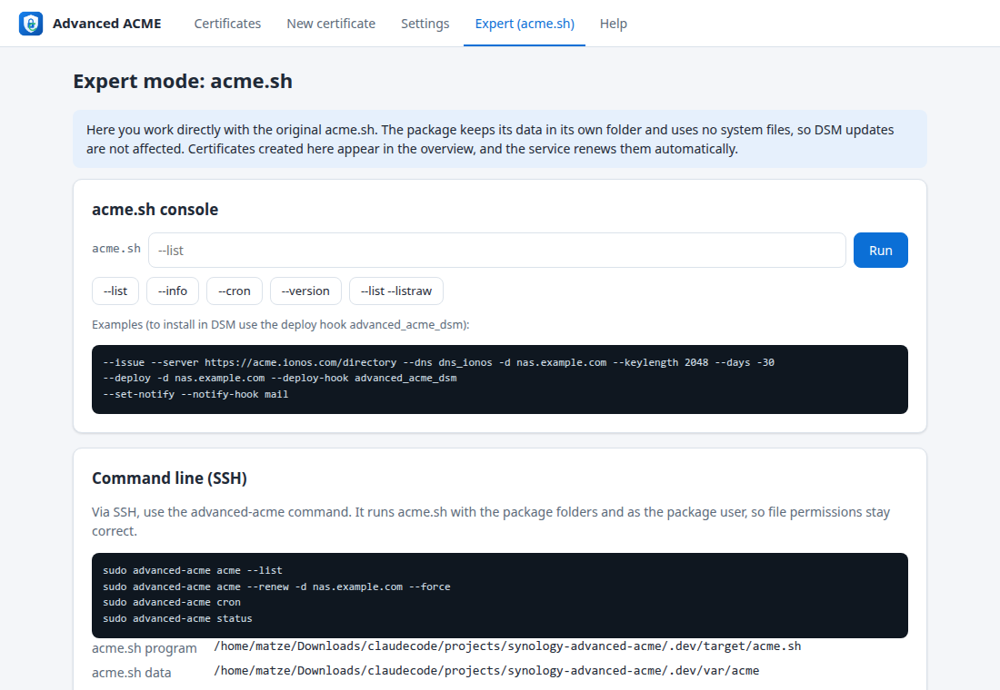

# Advanced ACME for Synology DSM

[Deutsche Version](README.de.md)

Automatic SSL certificates for Synology DSM 7 from **IONOS SSL**, Let's Encrypt, ZeroSSL or any other ACME server, set up with a guided assistant and renewed automatically.

Since 10 March 2026, IONOS issues SSL certificates with a technical validity of **180 days** instead of one year. A certificate installed by hand would have to be replaced twice a year. The IONOS ACME server needs *External Account Binding* (EAB), which the DSM certificate dialog does not support. Advanced ACME closes that gap.



## Features

- **Guided assistant for non-technical users**, with IONOS first. It explains step by step where to find the EAB data (Key ID and HMAC key) and the IONOS DNS API key, checks each entry immediately and lists the domains of your IONOS account to choose from.
- **DNS validation (DNS-01)**: the NAS does not need to be reachable from the internet, and no ports are opened. Supports IONOS and every other DNS provider supported by acme.sh (200+). Forms for those providers are generated from the acme.sh plugins.
- **Native DSM integration**: certificates are installed through the official DSM Web API into *Control Panel > Security > Certificate*. You can add a new certificate or replace an existing one. Service assignments, such as the DSM desktop or reverse proxy, stay in place after every renewal.
- **Automatic renewal** by a package service, twice a day, by default 30 days before expiry. The service supports ACME Renewal Information (ARI), so the CA can request an earlier renewal.
- **2-step verification**: the code is needed once, after which the NAS is a trusted device.
- **Expert mode**: an acme.sh console in the browser and an `advanced-acme` command for SSH. Certificates created there also appear in the overview and are renewed automatically.
- **acme.sh updates (optional, experimental)**: newer official acme.sh releases can be installed from *Settings*, manually or automatically once a day. The bundled version stays in place, and you can return to it with one click. Advanced ACME is tested with the bundled version only.
- **All 20 DSM languages**: English, German, French, Italian, Spanish, Dutch, Polish, Portuguese, Russian, Swedish, Danish, Norwegian, Czech, Turkish, Hungarian, Thai, Japanese, Korean, Simplified and Traditional Chinese. The app follows the DSM language, or the browser language outside DSM.

| Assistant: provider | Assistant: IONOS account | Expert mode |
|---|---|---|
|  |  |  |

## Why a package, and not a patch of the DSM certificate dialog?

The DSM certificate dialog is part of the operating system, under `/usr/syno`. Any change there is overwritten by the next DSM update. It can also make the update fail or leave DSM in an inconsistent state. Advanced ACME therefore keeps strictly to supported interfaces:

| | Advanced ACME |
|---|---|
| System files | none modified |
| Root rights | not needed: runs as its own package user (DSM 7 standard) |
| Cron jobs | none, so the DSM Security Advisor raises no warning. Renewals run in the package service |
| Data | `/var/packages/AdvancedACME/var`, survives DSM and package updates |
| Certificate installation | official DSM Web API, the same path as acme.sh's `synology_dsm` hook |
| acme.sh | the original, bundled as the official release 3.1.6 with one small adjustment (see below); newer releases can be installed optionally |

## Installation

1. Download `AdvancedACME-<version>-noarch.spk` from the releases, or build it yourself (see below).
2. In DSM, open **Package Center > Manual Install** and select the file. DSM warns that the package is not signed by Synology, which is normal for third-party packages.
3. Open **Advanced ACME** from the main menu and follow the assistant.

Requirements: DSM 7.0 or newer, any CPU architecture (`noarch`).

### What you need for IONOS

- An IONOS contract with a free **DV certificate** slot. OV and EV certificates cannot be issued via ACME.
- The domain must use the **IONOS name servers**.
- **EAB data**: in your IONOS account, open *SSL certificates*, then *ACME External Account Bindings* ([direct link](https://ssl.ionos.com/certificates/acme-accounts)), then *Create account*. You get a Key ID and an HMAC key. The HMAC key is shown only once.
- **An existing IONOS certificate set up by hand** must be linked to ACME once: on the IONOS page *SSL certificates*, choose *Manage* for the certificate, then *Advanced settings* > *Migrate to ACME*, and select the External Account Binding. Otherwise IONOS answers the request with “No available certificate found for the requested domain(s)”.
- **IONOS API key** for the DNS entries: create it in the [IONOS developer portal](https://developer.hosting.ionos.com/docs/getstarted). It consists of a public prefix and a secret.
- **A DSM administrator account**, entered once. By default the assistant uses it to create its own account `advanced-acme` (member of `administrators`, long random password) and stores only that account, so your own password is never saved. Experts can enter an existing account instead. As long as no DSM account is set up, the assistant starts with this step. DSM policies for new accounts are handled: if DSM requires a password change at the first sign-in, the account sets another random password itself.
- **Without an account: the DSM task.** If DSM requires 2-step verification for all administrators, no account of its own can sign in. Advanced ACME then offers to create the task “Advanced ACME” in the DSM Task Scheduler instead (one administrator sign-in, DSM asks for the password once more). The task runs every minute as root and installs renewed certificates locally with DSM's own `synowebapi`, the way DSM installs its Let's Encrypt certificates. No DSM account or password is stored. The error message also explains the alternative: exempt the account by choosing “Custom” 2-step verification enforcement with individually selected administrators.

## Security

- Only DSM administrators can open the application. The backend checks the DSM session and membership in the `administrators` group on every request. Requests need a custom header, which protects against CSRF.
- Access data (DNS API key, DSM account, EAB data) are stored in the package's data folder. The folder has mode `700` and its files `600`, so only the package user can read them. The DSM password is stored once, in `secrets/dsm.conf`, and is not copied into every acme.sh domain configuration.
- The account `advanced-acme` is created through the DSM Web API, without root rights. DSM refuses user management over the loopback address, so these calls use the NAS's own network address; certificates are installed over `localhost` as before. *Remove account* in the settings, switching to another account, or uninstalling with *delete data* deletes it from DSM again.
- The DSM task's script is stored in the task itself (root-owned). It never runs files of the package, only reads the certificates handed over, validates them, and writes its results to `/run/advanced-acme`, which belongs to root. It deletes itself when you remove it in Advanced ACME or uninstall the package.
- Every step of this kind (account created or deleted, task created, certificate installed by the task, task removed) is listed under *Settings > History*.
- Secrets are passed to background jobs through the environment, never on the command line. One exception: the EAB values are passed to acme.sh as arguments for the one-time `--register-account` call, because acme.sh only accepts them that way.
- DNS plugin variables are allowlisted per plugin, so the browser cannot set variables such as `PATH`. The expert console blocks options that would move or update acme.sh (`--home`, `--upgrade`, `--install` and others).

## acme.sh updates

The package ships the acme.sh release it was tested with (currently 3.1.6). Under *Settings > acme.sh version*, you can check for newer official releases, install one, or let the renewal service install new releases automatically once a day. These versions are **experimental with Advanced ACME**, and the interface shows a warning while one is active.

- The update is downloaded from the official acme.sh releases on GitHub and installed in the data folder (`var/acme-sh`). The bundled copy is never modified.
- One small adjustment is applied to the bundled acme.sh and to every update ([src/lib/acmepatch.sh](src/lib/acmepatch.sh)): after the order is finalized, acme.sh only polled 30 times, 2 seconds apart, for the certificate. The IONOS ACME server often needs several minutes, so acme.sh gave up although IONOS issued the certificate. With the adjustment it polls with increasing pauses (2, 5, 10, then 20 seconds) for about 9 minutes. If a later acme.sh release changes this code, the adjustment is skipped.
- An update is refused if the archive does not contain the expected version, if the Synology hook or the IONOS plugin is missing, or if a DNS plugin used by one of your certificates was removed.
- *Return to bundled version* deletes the updated copy. Certificates and settings are not affected.
- If a later package update ships a newer acme.sh than the installed update, the bundled version is used again automatically.

## Command line (SSH)

```bash
sudo advanced-acme acme --list
```

```bash
sudo advanced-acme acme --renew -d nas.example.com --force
```

```bash
sudo advanced-acme cron
```

```bash
sudo advanced-acme acme-update
```

`advanced-acme` switches to the package user automatically, so file ownership stays correct. To install a certificate into DSM, use the deploy hook `advanced_acme_dsm`. It uses the DSM account from the settings and calls acme.sh's original `synology_dsm` hook.

## Languages

All texts come from locale catalogs, with English as the base and fallback language:

- `src/ui/i18n/<language>.json`: the web interface (BCP 47 codes such as `fr`, `pt-BR`, `zh-TW`)
- `src/ui/texts/<DSM code>/strings`: main menu entry and DSM notifications (DSM codes such as `fre`, `ptb`, `cht`)
- `package/descriptions/<DSM code>.txt`: description in Package Center

The language is taken from the DSM session; outside DSM, from the browser. It can also be set under *Settings > Language*. Apart from English and German, the translations have not yet been reviewed by native speakers, so corrections are welcome. The wizard links to the IONOS site of the user's country where one exists (ionos.de, .fr, .es, .it), otherwise to ionos.com. `python3 tests/check-i18n.py` reports missing, extra or inconsistent texts in every language. To add a language, add the three files above and map its DSM code in `DSM_LANGS` in `src/ui/app.js`.

The acme.sh logs under *Show technical details* stay in English.

## Project layout

```
src/bin/advanced-acme            CLI and renewal service
src/lib/*.sh                     backend (bash 4.4, as shipped with DSM 7)
src/ui/                          web interface, CGI API, DSM app integration, locale catalogs
src/acme-hooks/deploy/           advanced_acme_dsm deploy hook
package/                         SPK control files and Package Center descriptions (INFO is generated by build.sh)
vendor/acme.sh/                  official acme.sh release (GPL-3.0), see tools/update-vendor.sh
tests/                           end-to-end test with Pebble and a DSM/IONOS mock
tools/                           build helpers
```

## Building

```bash
./build.sh
```

The result is `dist/AdvancedACME-<version>-noarch.spk`. It needs bash, tar and python3. The version is set in `VERSION`.

Other packaging systems can take only the package contents: `./build.sh --stage DIR` writes the files of `package.tgz` to `DIR` and uses an acme.sh that is already in `DIR/acme.sh` instead of `vendor/acme.sh`. With `ACME_UPDATES=0` the build leaves out the optional acme.sh updates from the interface; acme.sh is then updated only with the package. Advanced ACME finds its package name and package user at runtime, so the package may be named differently (for example `advanced-acme` with the user `sc-advanced-acme`).

## Tests

The end-to-end test runs the complete flow through the CGI API against [Pebble](https://github.com/letsencrypt/pebble). Pebble is set up like the IONOS ACME server: External Account Binding required, 180-day certificates. A mock of the DSM Web API (login, 2-step verification, certificate list and import, user management) and of the IONOS DNS API stands in for the NAS. The test covers registration with EAB, a wildcard certificate via DNS-01, installation in DSM, replacing the DSM default certificate, 2FA device tokens, renewal, ECDSA, the expert console, the service and input validation.

```bash
go install github.com/letsencrypt/pebble/v2/cmd/pebble@latest github.com/letsencrypt/pebble/v2/cmd/pebble-challtestsrv@latest
```

```bash
tests/e2e.sh
```

```bash
python3 tests/check-i18n.py
```

`tests/dev-env.sh` starts the same environment with the web interface at `http://127.0.0.1:8099/index.html`, for working on the UI.

## Status and limitations

- **Beta.** Tested end to end against Pebble and a DSM Web API mock, and on Virtual DSM 7.2.2: installation, the app in the DSM main menu, sign-in through the DSM session, issuing and installing a certificate, replacing the DSM default certificate, creating and deleting the DSM service account, the DSM task with 2-step verification enforced for all administrators (including replacing the default certificate and self-deletion on uninstall), renewal service, upgrade and uninstallation. Not yet tested against the live IONOS ACME server.
- IONOS documents its ACME server with Certbot and win-acme. Advanced ACME uses DNS-01 through the IONOS DNS API, which requires the IONOS name servers, as IONOS does anyway.
- Removing a certificate from Advanced ACME leaves it in DSM. Delete it there if you no longer need it.
- When uninstalling, a dialog asks whether to delete the stored access data and acme.sh data (preselected). Deleting them also deletes the DSM account `advanced-acme` if Advanced ACME created it. If you keep them, a reinstallation continues with them. Certificates installed in DSM remain either way, but are no longer renewed.

## SynoCommunity

Publishing in the [SynoCommunity](https://synocommunity.com) repository is planned once the package has been tested on real DiskStations. SynoCommunity builds all packages with its [spksrc](https://github.com/SynoCommunity/spksrc) framework, so the package will have to be ported to an spksrc `spk/` Makefile (noarch, `SERVICE_USER = auto`, DSM UI). Merging also requires a tested new installation and upgrade.

## License

GPL-3.0, see [LICENSE](LICENSE). Includes [acme.sh](https://github.com/acmesh-official/acme.sh) (GPL-3.0).

Synology and DSM are trademarks of Synology Inc. IONOS is a trademark of IONOS SE. This project is not affiliated with either company.
